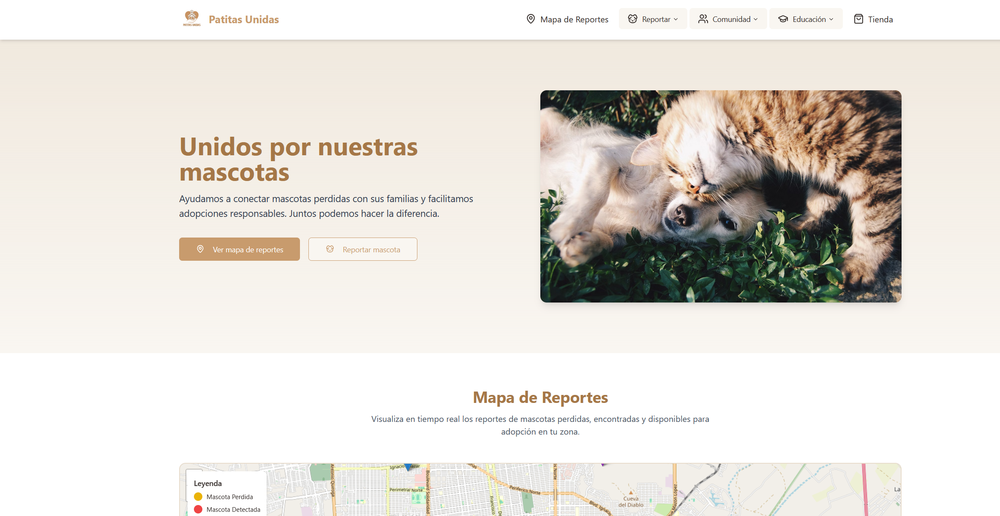
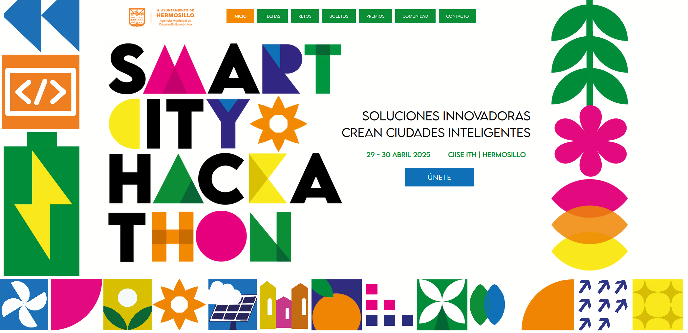

<i>Demo de Patitas Unidas (hecha con Lovable)</i>

**Patitas Unidas** es una app móvil hecha con **Flutter** y **Dart**, con **Firebase** como backend, diseñada para conectar mascotas en situación de calle o en adopción con personas que buscan darles un hogar. El proyecto se creó durante el **Smart City Hackathon de Hermosillo, Sonora**, celebrado el **29 y 30 de abril de 2025**.

La app se desarrolló en solo **36 horas** como parte de un equipo multidisciplinario que reunía a desarrolladores, diseñadores y perfiles de negocio. Se presentó en el pitch final en el **Parque La Ruina** y fue seleccionada como uno de los **proyectos finalistas**.

### Puntos destacados

- **Construida en Flutter con Firebase:** el frontend y el backend se conectaron con servicios de Firebase como Authentication, Firestore y Storage, con manejo de datos en tiempo real e infraestructura en la nube.
- **Prototipado rápido:** se desarrolló con un tiempo muy limitado, lo que exigió tomar decisiones de arquitectura con rapidez y entregar un MVP funcional en 36 horas.
- **Desarrollo multiplataforma:** la app se diseñó pensando en Android e iOS, aprovechando la interfaz casi nativa de Flutter.
- **Trabajo en equipo y comunicación:** el proyecto muestra mi capacidad para trabajar en un entorno colaborativo y contribuir tanto en el desarrollo técnico como en la coordinación del equipo.
- **Presentación en público:** estuve a cargo de **presentar el pitch final**, comunicando con claridad el valor y el propósito del proyecto ante el público.
- **Desarrollo continuo:** la app sigue en desarrollo, con planes para integrar más funciones como geolocalización, filtros de adopción y notificaciones.

Este proyecto refleja adaptabilidad, iniciativa y una base sólida en desarrollo de apps móviles, sobre todo en contextos de alta presión y poco tiempo como los hackathons.

<i>Desarrollada durante el Smart City Hackathon (sprint de 36 horas)</i>

