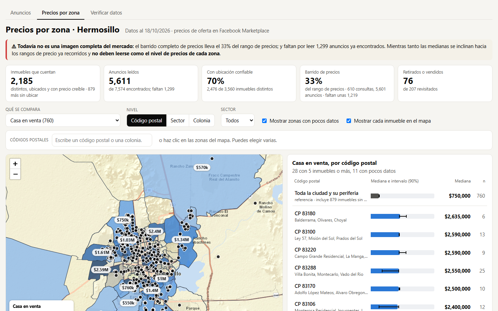
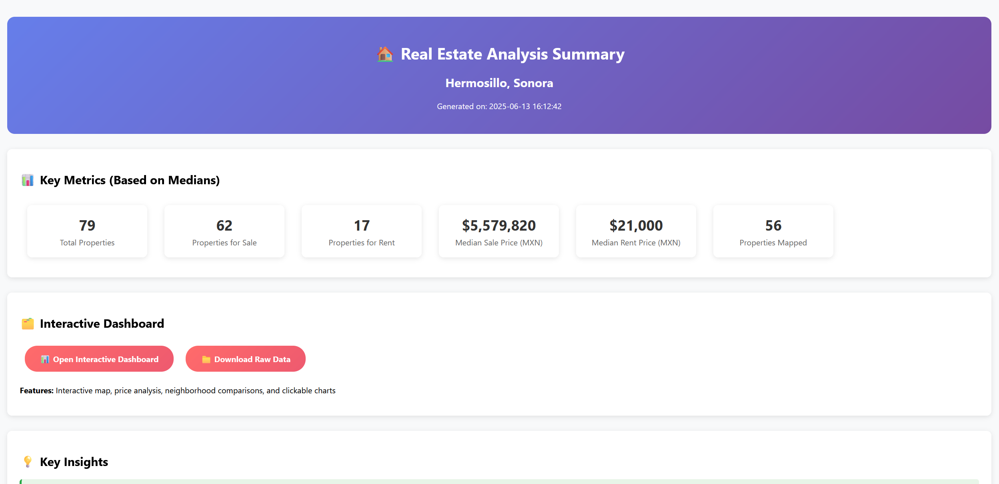
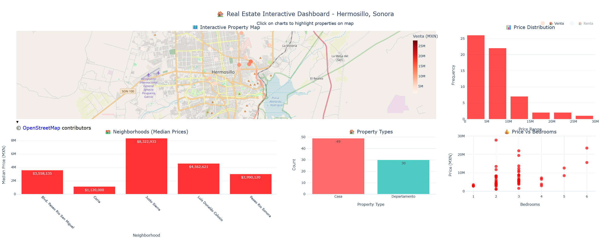

<i>Prices by zone dashboard. Basemap © Esri; postal codes © SEPOMEX (CC BY 4.0)</i>

What does a house in Hermosillo actually cost, zone by zone? Real estate portals show only a slice of the market, so I built my own data pipeline to answer it. The project has had two phases.

## Phase 2 (2026): a census of Facebook Marketplace listings

Most homes, land and rentals in Hermosillo are advertised on Facebook Marketplace, not on the big portals. This tool collects those listings every day and turns them into an analysis-ready dataset:

- **Collection.** Playwright sweeps Marketplace's public, logged-out pages by price band, so the whole market gets covered instead of only what a keyword search returns. Everything is stored in SQLite with price history, so it also tracks price drops and listings that disappear.
- **Relevance.** Three gates (where it looks, the listing card and the listing page) keep out the kitchen installers, prefab houses and "looking for a house" posts, and each gate's precision is measured instead of assumed.
- **Location.** Facebook's own map point is often a generic city pin, a median 2.3 km off. Positions come from what the seller wrote instead: Google Maps links, streets and crossings from OpenStreetMap, colonias from INEGI, and postal codes. About 70% of the properties end up with a trusted position.
- **Data quality.** It merges spellings of the same colonia, flags implausible prices with robust statistics, detects re-posts by fingerprinting photos, and uses a local language model (no outside AI service) to read areas and addresses the rules miss. A random sample is verified by hand to measure accuracy.
- **Outputs.** An interactive map, a dashboard of medians with 90% intervals per postal code, a CSV export and a terminal report.

In its first ten days it read over 6,000 listing pages, about 4,700 of them confirmed as real estate across 107 postal codes.

It's a personal research tool, and it's built to be polite: it never logs in, keeps to a small daily page budget, and stops whenever the site shows a login wall, a CAPTCHA or a block, without ever trying to get around one. The raw data stays on my computer; only aggregate figures like the dashboard above are shared.

## Phase 1 (2024): Century21 scraper for a construction company

<i>Phase 1 summary report</i>

The first version used **Python** and **Selenium** to collect land and property listings from **Century21**, helping a **construction company** monitor what was on the market and at what price instead of reviewing it by hand every day. The data went into CSV files and was visualized on interactive maps with **Pandas** and **Leaflet**.

<i>Phase 1 dashboard</i>

