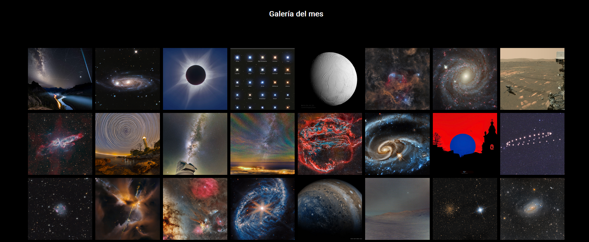
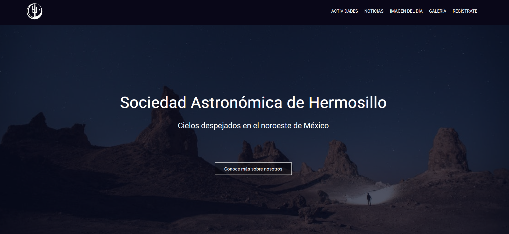

<i>Galería de la imagen del día</i>

Sitio web desarrollado para la **Sociedad Astronómica de Hermosillo**, con imágenes diarias del espacio desde la API de la NASA, una galería de actividades astronómicas locales y contenido educativo.

El proyecto se construyó desde cero con **JavaScript puro**, **HTML** y **CSS**, y está publicado en **GitHub Pages**. Fue un ejercicio práctico para reforzar los fundamentos del desarrollo web y mostrar la integración con APIs públicas.

### Puntos destacados

- **Integración con la API de la NASA:** la sección "Imagen del día" obtiene los datos automáticamente de la API pública de la NASA, lo que demuestra manejo de datos asíncronos, JSON e integración con APIs de terceros.
- **Enfoque educativo y comunitario:** el sitio incluye una galería y secciones informativas para apoyar la divulgación astronómica local y los esfuerzos educativos.
- **Mejoras de rendimiento en curso:** el sitio se está refactorizando para mejorar su rendimiento con **carga diferida (lazy loading)**, una entrega de recursos más eficiente y un mejor manejo de las llamadas a la API para que escale.
- **Arquitectura basada en APIs públicas:** además de la API de la NASA, la visión a largo plazo es alimentar el sitio con varias APIs públicas para demostrar un manejo de datos avanzado y la automatización de contenido.
- **Node como gestor de paquetes:** aunque el sitio no usa un framework completo, **Node.js** gestiona las dependencias del proyecto y automatiza partes del flujo de trabajo, siguiendo buenas prácticas del frontend moderno.

Es un proyecto en evolución que refleja un compromiso continuo con aprender, mejorar la calidad del código y entender a fondo las tecnologías web más allá de los frameworks.

<i>Página de inicio de la Sociedad Astronómica</i>

